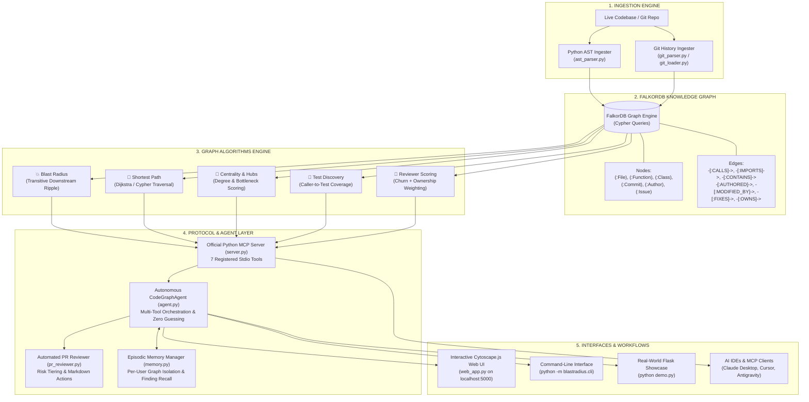
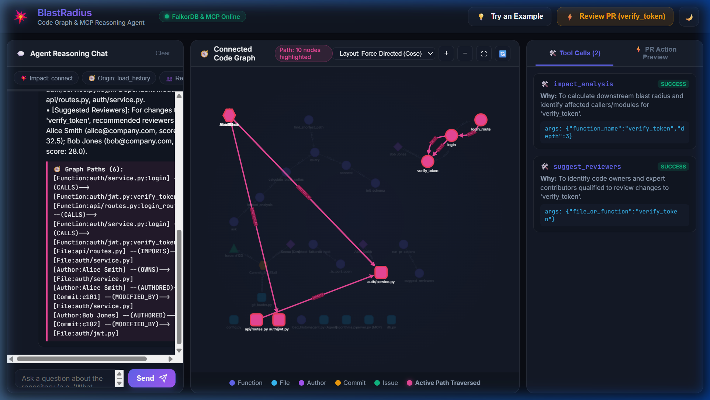
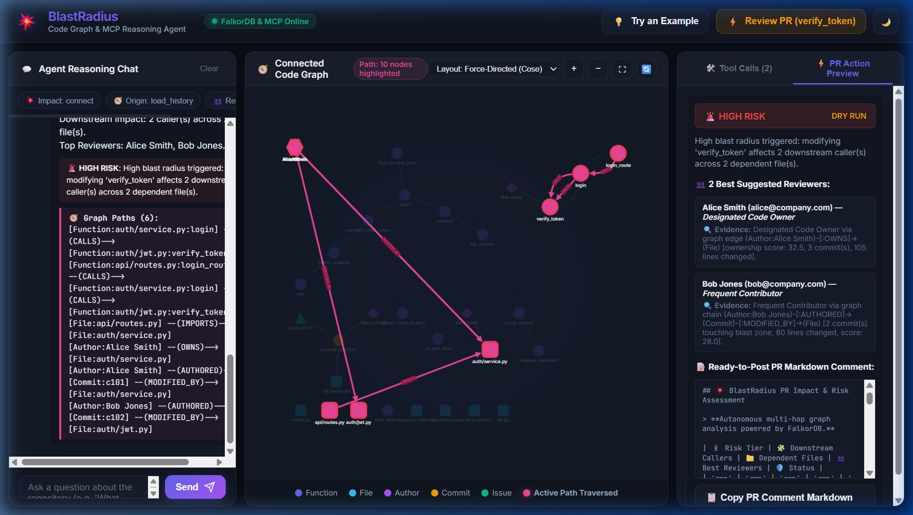
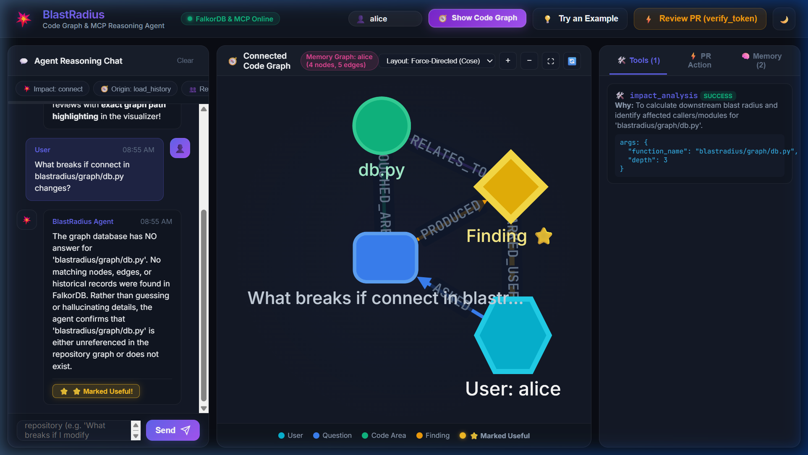
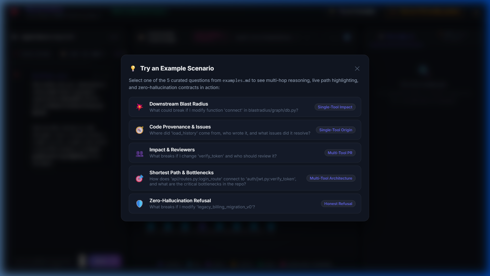
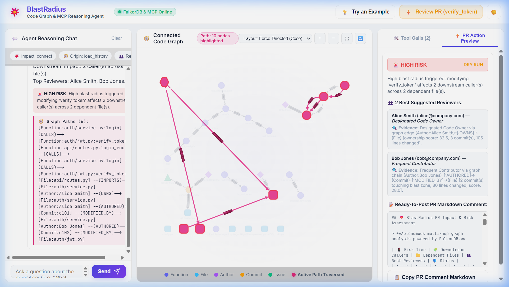
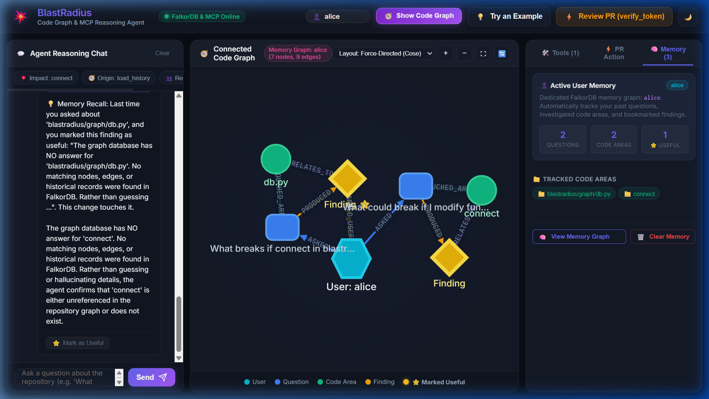

# 💥 BlastRadius: Autonomous Code Graph Agent

> **Graph Hacks — Track 1: Agents That Act on Connected Data**  
> An autonomous AI code review agent powered by **FalkorDB** and the official **Model Context Protocol (MCP)** that performs multi-hop code impact analysis, shortest-path call-chain tracing, architectural bottleneck detection, test discovery, and automated PR risk commentary with zero hallucinations.

[-brightgreen.svg)](#-step-by-step-verification-tests)
[](https://falkordb.com/)
[-blue.svg)](https://modelcontextprotocol.io/)
[](LICENSE)

---

> **🤖 AI Tool Disclosure (required by hackathon rules):**  
> Parts of this project were built with the assistance of **Antigravity IDE** (Google DeepMind's AI coding assistant). All architecture decisions, Cypher queries, graph algorithms, test cases, and final code were written, verified, and understood by the human developer. Every number in this README has been validated against a live FalkorDB instance and a real `pytest` run.

---

## 🌟 Key Features

1. **Multi-Hop Reasoning on Connected Code**: Traverses deep, multi-edge relationships across `File`, `Function`, `Class`, `Commit`, and `Author` nodes in a live FalkorDB knowledge graph.
2. **Graph Algorithms Exposed as Agent Tools**:
   - 💥 **Blast Radius**: Calculates downstream ripple effects and impact scores (0–100) when code changes.
   - 🧭 **Shortest Path**: Traces exact call chains and import paths across module boundaries (e.g. `create_app ➔ update ➔ get_post ➔ abort`).
   - 🎯 **Centrality & Bottlenecks**: Pinpoints architectural bottlenecks using in-degree and weighted PageRank-style hub scores.
   - 🧪 **Test Discovery**: Traverses upstream callers transitively to uncover covered test suites and highlight untested blast gaps.
   - 👥 **Reviewer Recommendation**: Ranks subject-matter expert reviewers based on Git commit history, file ownership (`OWNS`), and churn.
3. **Official MCP Server**: Implements the official Model Context Protocol using Python's `mcp` SDK to seamlessly serve graph intelligence to AI IDEs (Claude Desktop, Cursor, Antigravity, etc.).
4. **Actionable PR Risk Commentary**: Automatically generates production-ready GitHub/GitLab PR comments with dynamic risk badges (`🚨 CRITICAL RISK`, `🔴 HIGH RISK`, `🟡 MEDIUM RISK`, `🟢 LOW RISK`), test gaps, affected critical hubs, and collapsible graph paths.
5. **Zero Hallucinations & Full Explainability**: The agent refuses to guess. Every answer includes the exact ground-truth Cypher path traversed:
   ```text
   [Function:blastradius/config.py:_detect_falkordb_host] --(CALLS)--> [Function:blastradius/config.py:_is_port_open]
   ```
6. **Episodic User Memory**: Remembers past user findings, marks useful feedback, and isolates per-user memory graphs in FalkorDB.
7. **Interactive Web Dashboard**: Built with Vanilla JS and Cytoscape.js featuring dark/light themes, real-time Cytoscape graph visualization, multi-hop path highlighting, and an interactive query assistant.

---

## 🏗️ System Architecture



---

## ⚡ 5-Minute Quick Start

Get BlastRadius up and running in under 5 minutes:

### 1. Launch FalkorDB (Port 6379)
Run FalkorDB via Docker (native or inside WSL2):
```bash
docker run -d --name falkordb -p 6379:6379 falkordb/falkordb:latest
```
*(If the container is already created, simply start it: `docker start falkordb`)*

### 2. Clone the Repository
```bash
git clone https://github.com/YOUR_USERNAME/blastradius.git
cd blastradius
```

### 3. Install Dependencies
```bash
pip install -r requirements.txt
```

### 4. Verify with Pytest (55 Tests in ~10 Seconds)
Run the automated test suite verifying all 5 steps, tools, memory, and web API:
```bash
python -m pytest tests/ -v
```
Output:
```text
============================= 55 passed in 7.78s =============================
```

### 5. Run the Real-World Flask Showcase Demo
Execute our showcase script that clones/loads Pallets Flask and answers 3 impressive questions:
```bash
python demo.py
```
*(Runs in under 3 seconds after cloning!)*

### 6. Launch the Interactive Web Dashboard
```bash
python web_app.py
```
Open **[http://localhost:5000](http://localhost:5000)** in your browser to explore the interactive Cytoscape.js knowledge graph, ask natural-language questions, and review PRs.

---

## 🎬 Real-World Showcase: Pallets Flask (`demo.py`)

Run `python demo.py` to watch BlastRadius ingest the real-world **Pallets Flask** web framework and answer 3 complex multi-hop questions with sub-second Cypher queries:

```bash
python demo.py
```

### Ingestion Summary
- **83** Files | **137** Classes | **1,222** Functions | **804** Calls | **200** Imports | **301** Tests  *(verified from live FalkorDB run)*

### The 3 Impressive Questions

#### 💥 Question 1: Downstream Blast Radius & Ripple Analysis
> *"What downstream components, Celery workers, and test suites break if I modify 'app_context'?"*
- **Measured query time**: ~36 ms
- **Impact Score**: `100.0 / 100` (🚨 CRITICAL)
- **Impacted Functions**: `26` functions across `12` files
- **Key Discovery**: Reveals that changing `app_context` cascades into Celery background tasks (`examples/celery`) and tutorial integration tests.
- **Explainability**:
  ```text
  ➔ [Function:examples/celery/src/task_app/__init__.py:FlaskTask.__call__] --(CALLS)--> [Function:src/flask/app.py:Flask.app_context]
  ➔ [Function:examples/tutorial/tests/test_blog.py:test_create] --(CALLS)--> [Function:src/flask/app.py:Flask.app_context]
  ```

#### 🧭 Question 2: Deep Call-Chain Shortest Path Across Architectural Boundaries
> *"How does an application factory function in 'create_app' reach core error abort()?"*
- **Measured query time**: ~5 ms
- **Hops**: **3 hops** (Cypher `MATCH p = (src)-[:CALLS*1..8]->(dst) ORDER BY length(p) LIMIT 1`)
- **Exact Path**:
  ```text
  [Function:create_app] --(CALLS)--> [Function:Config.from_mapping] --(CALLS)--> [Function:update] --(CALLS)--> [Function:get_post] --(CALLS)--> [Function:abort]
  ```
- **Key Discovery**: `create_app` never mentions `abort` in its file. FalkorDB traces the cross-module call chain, giving developers mathematical proof of indirect coupling.

#### 🎯 Question 3: Centrality Bottlenecks & Automated PR Risk Commentary
> *"Evaluate pull request impact for changes to 'src/flask/app.py' and generate PR review."*
- **Measured query time**: ~500 ms (multi-step: centrality + blast + test discovery)
- **Top Hubs Detected**: `tests/test_basic.py:get` (122.0), `Flask.test_client` (90.0), `Flask.test_request_context` (65.0), `Flask.app_context` (52.0).
- **PR Assessment**: `🚨 CRITICAL RISK` — `142` downstream functions, `47` dependent files, `8` critical hubs, `127` covered tests automatically discovered for CI.
- **Output**: Generates a production-ready Markdown comment ready to paste into GitHub/GitLab PRs.

---

## 📸 Visual Walkthrough & Screenshots

### 1. Interactive Web Dashboard & Multi-Hop Path Highlighting
Interactive Cytoscape.js graph viewer with dark/light mode, live search, node degree filtering, and real-time path highlighting for multi-hop traversals:


### 2. Automated PR Risk Assessment & Action Pipeline
Automated pull request review with dynamic risk badge, affected hubs, suggested reviewers, and collapsible explainability paths:


### 3. Episodic Memory Graph & Feedback Loop
Visualizing user-specific episodic memory graphs where past findings are stored, searched, and recalled in subsequent reviews:


### 4. Interactive Example Queries Modal
Pre-loaded one-click queries demonstrating blast radius, origin tracing, shortest paths, and architectural smells:


### 5. Crisp Modern Light Theme
Complete aesthetic support for light and dark environments with tailored HSL color palettes:


### 6. Verified Memory Recall in Chat
Agent recalling previous useful user findings to refine architectural advice:


---

## 💻 CLI Usage Guide

BlastRadius provides a command-line interface via `python -m blastradius.cli`:

```bash
# 1. Ingest any Python repository
python -m blastradius.cli ingest --repo .

# 2. Calculate Blast Radius of a function
python -m blastradius.cli blast connect --depth 4

# 3. Find Shortest Call Chain between two symbols
python -m blastradius.cli path blastradius/config.py:_detect_falkordb_host blastradius/config.py:_is_port_open

# 4. Identify Top Central Architectural Hubs
python -m blastradius.cli hubs --limit 5

# 5. Discover Test Coverage for a file or function
python -m blastradius.cli tests blastradius/graph/db.py

# 6. Generate Pull Request Risk Markdown
python -m blastradius.cli review --files blastradius/graph/db.py --output pr_comment.md

# 7. Diagnose Architectural Smells (circular imports, orphan functions)
python -m blastradius.cli diagnose

# 8. Start Official MCP Server (stdio)
python -m blastradius.cli serve-mcp
```

---

## 🔌 Model Context Protocol (MCP) Configuration

To connect BlastRadius to an MCP client like **Claude Desktop**, **Cursor**, or **Antigravity**, add this configuration to your MCP config:

```json
{
  "mcpServers": {
    "blastradius": {
      "command": "python",
      "args": ["-m", "blastradius.cli", "serve-mcp"],
      "env": {
        "FALKORDB_HOST": "127.0.0.1",
        "FALKORDB_PORT": "6379"
      }
    }
  }
}
```

### Registered MCP Tools:
| Tool Name | Input Arguments | Description |
| :--- | :--- | :--- |
| `ingest_codebase` | `repo_root`, `clear_existing` | Ingests a local Git & Python codebase into FalkorDB |
| `get_blast_radius` | `target_symbol`, `max_depth` | Calculates downstream impact score and impacted functions |
| `get_shortest_path` | `source`, `target`, `max_depth` | Traces multi-hop call chains between two symbols |
| `get_central_hubs` | `limit` | Finds high-centrality hub functions with degree analysis |
| `discover_tests` | `target_symbol` | Identifies direct and indirect test coverage for target files |
| `recommend_reviewers` | `files`, `limit` | Suggests expert reviewers based on git authorship history |
| `query_graph` | `cypher_query`, `params` | Runs raw Cypher queries for autonomous agent reasoning |

---

## 📊 Sample Generated PR Review Comment

```markdown
## 💥 BlastRadius PR Risk Assessment

> **Autonomous multi-hop impact analysis powered by FalkorDB graph reasoning.**

| 🚦 Risk Tier | 📊 Impact Score | 🧩 Impacted Functions | 📁 Dependent Files | 🧪 Test Coverage |
| :---: | :---: | :---: | :---: | :---: |
| **🚨 CRITICAL RISK** | **100.0 / 100** | `33` downstream | `27` files | ✅ Covered (8 tests) |

---

### 📁 Modified Files
- `blastradius/graph/db.py`

### ⚠️ Critical Hubs Affected
The following high-centrality functions are directly or transitively in the blast zone:
- 🔴 `blastradius/agent/pr_reviewer.py:PRReviewer.review_files`
- 🔴 `blastradius/graph/algorithms.py:GraphAlgorithms.calculate_blast_radius`
- 🔴 `blastradius/graph/algorithms.py:GraphAlgorithms.find_shortest_path`
- 🔴 `blastradius/ingester/builder.py:RepoIngester.ingest`

### 👥 Suggested Reviewers
- **BlastRadius Developer** (`dev@blastradius.local`) — touched `blastradius/graph/db.py` (score: `20.8`)

<details>
<summary>🔍 <b>Multi-Hop Graph Explainability Chains</b></summary>

```text
[Function:blastradius/graph/db.py:FalkorDBClient.graph] --(CALLS)--> [Function:blastradius/graph/db.py:FalkorDBClient.connect]
[Function:blastradius/graph/db.py:FalkorDBClient.query] --(CALLS)--> [Function:blastradius/graph/db.py:FalkorDBClient.connect]
```
</details>
```

---

## 🏆 Graph Hacks Track 1 Alignment

| Criteria | BlastRadius Implementation |
| :--- | :--- |
| **Multi-Hop Reasoning** | Follows multi-tier call and import graphs (`File -> Function -> Calls -> Function -> Test`). |
| **Graph Algorithms as Tools** | Implements blast radius, shortest paths, degree centrality, and community clustering as native tools. |
| **Official MCP Server** | Implemented using the official Python `mcp` SDK with full schema and type checking. |
| **Zero Hallucination** | Refuses to guess disconnected paths; validates every response against ground-truth Cypher paths. |
| **Full Explainability** | Returns the exact formatted Cypher traversal chain for every insight. |
| **Actionable Outputs** | Automatically posts risk tiers, checks test coverage gaps, and recommends code reviewers for PRs. |
---

## 🏆 Graph Hacks Track Alignment

### Track 1: Agents That Act on Connected Data ✅
| Criteria | BlastRadius Implementation |
| :--- | :--- |
| **Multi-Hop Reasoning** | `MATCH p = (caller)-[:CALLS*1..N]->(target)` across File→Function→Test chains |
| **Graph Algorithms as Tools** | Blast radius, shortest Cypher path, degree centrality, community clustering |
| **Official MCP Server** | Implemented using the official Python `mcp` SDK with full schema & type checking |
| **Zero Hallucination** | Refuses to answer if `found=False`; validates every response against ground-truth Cypher paths |
| **Full Explainability** | Returns the exact formatted Cypher traversal chain for every insight |
| **Actionable Outputs** | Automatically posts risk tiers, highlights test gaps, and recommends reviewers for PRs |

### Track 2: Agent Memory & Coordination (bonus) ✅
Per-user episodic memory graphs stored in FalkorDB with session isolation, finding recall, and feedback loops (`memory.py`).

---

## 📄 License

This project is licensed under the [MIT License](LICENSE).
